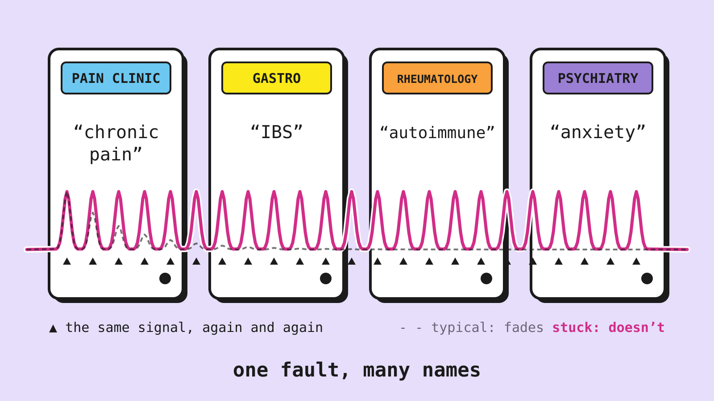

{: .post-hero}

**Some conditions travel together far more often than chance allows:** chronic pain, IBS, autoimmune disease, anxiety and mood disorders, sensory over-responsivity. Each gets its own specialist and its own name, and the people who have several of them get treated one specialist at a time.

This post is about two questions no single field can ask about those people. **What do they have in common? And what makes them different?**

My guess at the first: **a nervous system that fails to habituate**, one that keeps reporting a signal it should have tuned out. My guess at the second: the fault is the same, but it lands in different places, and where it lands decides which diagnoses a person collects. So "how stuck?" gets asked separately from "which organ?" The rest of the post is about how to measure both.

Follow-up to [Biome of Overstimulation: Sensory Sensitivity as a Unifying Mechanism](/biome/). That post was joint work with Luca Estinto; this one is my own.

> ### ⚠ A caveat
>
> This is a hypothesis, and it has not been tested. The figures are illustrations with made-up numbers, not data. None of this is medical advice.

The trouble is that the evidence comes in pairs. Every link anyone has found between these conditions was found in its own group of people: adults in Danish and Swedish hospital records, autistic kids whose parents filled in questionnaires, people who can't stand perfume.<a href="#src-1">1</a>–<a href="#src-6">6</a> Click a study to see who it looked at and what it found.

<iframe class="biome-embed" data-embed="one-fault-0" src="/embeds/one-fault.html?act=0" title="Six conditions, with each known link coloured by the group of people it was found in" loading="lazy" allowtransparency="true" style="display:block;background:transparent;width:100%;height:520px;border:0;margin:1.5rem 0;"></iframe>

Nobody has looked at all of them in the same people. That's what the rest of this post is about.

## 1 · What I propose: measure habituation as a slope

This is a proposal; nobody has run it yet. Deliver the same stimulus ten times. A typical nervous system decrements: each response is smaller. The faulty one keeps reporting at full strength. The number I propose to read off is the **failure-to-decrement slope**, one per channel. A channel would be one instrument run this way; the battery I propose has about six (all listed in section 4).

<iframe class="biome-embed" data-embed="one-fault-1" src="/embeds/one-fault.html?act=1" title="Response amplitude over ten identical stimuli, healthy versus non-habituating" loading="lazy" allowtransparency="true" style="display:block;background:transparent;width:100%;height:360px;border:0;margin:1.5rem 0;"></iframe>

It needs no new equipment: the instruments every clinic already owns (QST, barostat, evoked responses) would just be run in **repeated mode**, reading the same quantity off each. Some of these have been run this way on their own, in their own groups of people; what I propose is running all of them on the same people.

The math: the vector h

With $$k$$ channels, person $$i$$ would have a habituation deficit vector

$$h_i \in \mathbb{R}_{\ge 0}^k,$$

where $$h_i^{(\alpha)}$$ is the failure-to-decrement slope on channel $$\alpha$$.

The channels I propose: cutaneous QST, temporal summation, conditioned pain modulation (CPM), barostat, evoked responses, a parent- or self-reported sensory profile, and possibly affective reactivity.

## 2 · h = s · u: severity times direction

One slope per channel gives a vector h. Its length s says **how bad** the shared fault is; its direction u on the sphere says **where it lands**. Drag the point: same severity, different direction, different diagnosis.

<iframe class="biome-embed" data-embed="one-fault-2" src="/embeds/one-fault.html?act=2" title="Direction simplex with draggable patient point" loading="lazy" allowtransparency="true" style="display:block;background:transparent;width:100%;height:520px;border:0;margin:1.5rem 0;"></iframe>

So s is what these people have in common, and u is what makes them different. Two people with **equal s** but different u sit in different clinics under different names. The specialty boundaries slice one object. Diseases get named after the organ until an instrument names the cause.

The triangle shows only three channels, one per body system, so the sphere fits on a screen: **skin** (QST), **gut** (barostat) and **cortex** (evoked responses). The real battery has **k ≈ 6 instruments** (section 4), several per body system: QST, temporal summation and CPM all probe the pain system; the barostat is the gut channel; evoked responses are cortex. In the model, u lives on Sk−1.

The math: severity, direction and the population model

$$h_i = s_i\,u_i, \qquad s_i = \lVert h_i \rVert_2,$$

$$u_i = h_i / s_i \in S^{k-1}_+,$$

$$S^{k-1}_+ := S^{k-1} \cap \mathbb{R}^k_{\ge 0}.$$

Slopes are non-negative, so directions live on the positive part of the sphere. Across people:

$$s_i \sim p_s, \qquad z_i \sim \mathrm{Cat}(\pi),$$

$$u_i \mid z_i = j \;\sim\; \mathrm{vMF}(\mu_j, \kappa_j)\big\vert_{S^{k-1}_+},$$

with cluster centres $$\mu_j \in S^{k-1}_+$$, concentrations $$\kappa_j > 0$$ and weights $$\pi$$. The working assumption is that severity and direction are independent given the cluster. If they are not, the mixture is fit jointly on $$(s, u)$$: the same kind of problem with one more block of parameters.

## 3 · Directions cluster, or the hypothesis dies

Model u across the population as a mixture of von Mises–Fisher components. The claim: a **small number of tight clusters** (m = 3–6, large κ). It is falsified if directions are uniform, or one diffuse blob.

<iframe class="biome-embed" data-embed="one-fault-3" src="/embeds/one-fault.html?act=3" title="Population of direction points on the simplex under three hypotheses" loading="lazy" allowtransparency="true" style="display:block;background:transparent;width:100%;height:520px;border:0;margin:1.5rem 0;"></iframe>

Nobody has measured these slopes across channels in the same people, so the clustering idea has never really been tested. But a few nearby findings point the same way. When people with nerve pain go through a full panel of sensory tests, they fall into three groups rather than one smear.<a href="#src-7">7</a> Autistic kids' sensory quirks sort into a handful of types, and almost all of them are still the same type a year later.<a href="#src-8">8</a> And in migraine, the brain's response to a repeated stimulus fails to die down between attacks, which is the slope from the first figure, in one channel and one diagnosis.<a href="#src-9">9</a> Nobody has put the three together, because nobody has run the whole battery in repeated mode.

The numbers

- Nerve pain: 902 patients, three profiles (sensory loss 42%, thermal hyperalgesia 33%, mechanical hyperalgesia 24%), replicated in 233 more, across different causes of the neuropathy.
- Autism: parent questionnaires on 1,294 children, four sensory subtypes, 91% in the same subtype a year later.
- Migraine: lack of habituation of evoked responses between attacks, reviewed across many studies.

The math: tests and power

The hypotheses: $$H_0^{\text{unif}}$$, directions uniform on $$S^{k-1}_+$$; $$H_0^{\text{uni}}$$, one diffuse component ($$m = 1$$, small $$\kappa$$); $$H_A$$, $$m \in \{3, \dots, 6\}$$ with every $$\kappa_j$$ large.

- **Uniformity.** The usual tests (Rayleigh, Bingham) have known null distributions for the whole sphere. Uniform directions on the positive part already have a non-zero mean, so their null distributions have to be simulated here.
- **Number of clusters.** Report the BIC curve over $$m$$, and back it up with a parametric-bootstrap likelihood-ratio test of $$m$$ against $$m - 1$$, since the standard asymptotics fail on the boundary.
- **Tightness.** Estimate each $$\kappa_j$$ with a bootstrap interval; the claim is that $$\min_j \kappa_j$$ is large.

A rough power calculation: with four equal clusters 30° apart and $$\kappa = 50$$, a few hundred people are enough; with $$\kappa = 20$$, about 500. The limit is which channels are measured, not how many people.

Cluster membership should predict which diagnoses a person **later collects**, out of sample, better than any single-channel score. And u should be stable within a person while s tracks flares:

<iframe class="biome-embed" data-embed="one-fault-5" src="/embeds/one-fault.html?act=5" title="One person over twelve months: severity rises and falls while direction stays put, or drifts" loading="lazy" allowtransparency="true" style="display:block;background:transparent;width:100%;height:420px;border:0;margin:1.5rem 0;"></iframe>

If a person's direction wanders from gut to skin to cortex over a year, the fault has no fixed address and the decomposition is not describing anything stable.

The math: is u a stable signature?

Measure each person at times $$t = 1, \dots, T$$, giving $$u_{i,t}$$. Take each person's Fréchet mean on the sphere,

$$\bar u_i = \arg\min_{v \in S^{k-1}_+} \sum_{t=1}^T d(u_{i,t}, v)^2,$$

where $$d(u, v) = \arccos \langle u, v \rangle$$,

and split the spread into within-person and between-person parts:

$$\sigma_W^2(i) = \tfrac{1}{T} \sum_t d(u_{i,t}, \bar u_i)^2,$$

$$\sigma_B^2 = \tfrac{1}{n} \sum_i d(\bar u_i, \bar u)^2,$$

$$\mathrm{ICC}_u = \frac{\sigma_B^2}{\sigma_B^2 + \mathbb{E}[\sigma_W^2]}.$$

The prediction: $$\mathrm{ICC}_u \ge 0.7$$ (direction is a personal signature) while the same ratio for $$s$$ is low (severity tracks flares). As a model, $$u_{i,t} \mid \bar u_i \sim \mathrm{vMF}(\bar u_i, \kappa_W)$$ and $$\bar u_i \mid z_i = j \sim \mathrm{vMF}(\mu_j, \kappa_j)$$, fit by EM; the testable statement is $$\kappa_W \gg \max_j \kappa_j$$.

Rough power: three visits each for 100 people separate $$\mathrm{ICC}_u = 0.7$$ from $$0.3$$. Separating 0.7 from 0.5 takes about 250 people with three visits, or about 100 with five. More visits per person buys more than more people.

## 4 · No cohort sees the whole vector

Here are all six channels, grouped by body system. Every dataset observes a different coordinate projection of h, and no person appears twice. Cross-block dependence is only loosely bounded: the classical statistical-matching obstruction. The s · u structure buys identification back; a small **bridging sample** with the full battery checks it.

<iframe class="biome-embed" data-embed="one-fault-4" src="/embeds/one-fault.html?act=4" title="Cohorts by channels observation grid with optional bridging sample" loading="lazy" allowtransparency="true" style="display:block;background:transparent;width:100%;height:400px;border:0;margin:1.5rem 0;"></iframe>

The registries know who was diagnosed with what, and nothing about anyone's senses. The autism cohorts, SPARK<a href="#src-10">10</a> and the Simons Simplex Collection,<a href="#src-11">11</a> have parent questionnaires and genetics, and I still need to go through which sensory, gut and immune questions they actually asked. None of them ran a single sensory test like the one in the first figure. The last row isn't a real cohort, just the kind of study a pain clinic runs: the pain tests and nothing else.

So can the pieces be glued back together? Mostly, if three things hold: every channel gets measured by somebody, the clusters look different from at least one cohort's point of view, and the cohorts overlap enough that you can tell it's the same cluster as you go from one to the next. If the model is right, that's enough. If it's wrong about two channels nobody ever measured together, the data can't tell you. That's what the bridge is for: a few hundred people already in SPARK who do the whole battery. At the very least that means adding a gut test and a brain-response test for people who have already done the rest. (How many people, exactly, is in the box below.)

The math: identifiability and the bridge

Cohort $$c$$ observes the channels $$S_c \subseteq \{1, \dots, k\}$$ on $$n_c$$ people, none shared between cohorts:

$$y_i^{(c)} = s_i\, u_i\big\vert_{S_c} + \varepsilon_i^{(c)},$$

$$\varepsilon_i^{(c)} \sim \mathcal{N}(0, \Sigma_c).$$

Within one cohort this is again a severity times a direction, on a smaller sphere: $$y = (s\rho)\,\tilde u + \varepsilon$$ with $$\rho = \lVert u\vert_{S_c} \rVert$$. For large $$\kappa_j$$, $$\tilde u$$ is approximately $$\mathrm{vMF}(\tilde\mu_j^{(c)}, \kappa_j \rho_j^{(c)\,2})$$, where $$\tilde\mu_j^{(c)} = \mu_j\vert_{S_c} / \rho_j^{(c)}$$. So one cohort identifies the weights $$\pi_j$$, the restricted centres $$\mu_j\vert_{S_c}$$, and only the products $$\kappa_j \rho_j^{(c)\,2}$$; a second cohort with a different $$\rho_j$$ separates $$\kappa_j$$.

**Working claim** (proof sketched in my notes). Assume $$s \perp u \mid z$$ and that $$p_s$$ has positive density on $$(0, \infty)$$. Then $$\theta = (p_s, \pi, \{\mu_j, \kappa_j\})$$ is identified up to relabelling the clusters if and only if

1. **coverage:** $$\bigcup_c S_c = \{1, \dots, k\}$$;
2. **discriminability:** for every pair of clusters $$j \neq j'$$, some cohort sees $$\tilde\mu_j^{(c)} \neq \tilde\mu_{j'}^{(c)}$$;
3. **overlap chain:** a chain of cohorts covering all channels, consecutive ones overlapping, with condition 2 holding on each overlap.

The information is then additive over cohorts, $$\mathcal{I}(\theta) = \sum_c n_c\, \mathcal{I}_c(\theta)$$.

What the marginals cannot see: for a channel pair $$(\alpha, \beta)$$ never measured together, any departure from the vMF mixture in their joint behaviour (heavier tails, severity coupled to particular coordinates) is only Fréchet–Hoeffding bounded. That is the case for the bridge.

Bridge sizes: $$\mathrm{Var}(\hat\rho_{\alpha\beta}) \approx (1 - \rho_{\alpha\beta}^2)^2 / n_b$$ gives standard error 0.05 at $$n_b \approx 400$$ and 0.10 at $$n_b \approx 100$$. To detect a residual correlation $$\delta$$, $$n_b \gtrsim (z_{1-\alpha/2} + z_{1-\beta})^2 / \delta^2$$: about 350 for $$\delta = 0.15$$ at 80% power, about 650 with a Bonferroni correction over 20 pairs.

To rank which instrument to add next, use the expected information gain

$$\mathrm{EIG}(\alpha^\star) = \mathbb{E}\big[\log\det(\mathcal{I} + \mathcal{I}_{\alpha^\star})$$

$$\qquad\qquad - \log\det \mathcal{I}\big].$$

It is largest for sparsely covered channels, for directions the cluster centres span that no measured channel does, and for low-noise instruments.

What I don't know yet:

- **Which parts of s and u can actually be recovered** from cohorts that each see only a few channels?
- **How small can the bridge be** and still catch the model being wrong?
- **How do you fit this without deleting the answer?** The fast standard method, mean-field inference, treats the hidden quantities as uncorrelated,<a href="#src-12">12</a> and those correlations are exactly what the question is about.

And the biggest one needs data, not math: **what happens when you run several sensory tests, in repeated mode, on the same person?** Every cohort so far has one or two channels at most. The whole idea depends on measuring the same people across skin, gut and brain, and nobody has done that yet.

The math: inference

A factorised approximation $$q(\theta) = \prod_\ell q_\ell(\theta_\ell)$$ sets every posterior correlation to zero, and for Gaussian targets it underestimates the marginal variances.<a href="#src-12">12</a> Here the posterior is correlated by construction: each person's $$(s_i, u_i)$$ through $$h_i = s_i u_i$$; cluster centres across blocks through the chain of overlapping cohorts; and $$(\pi, \mu_j, \kappa_j)$$ whenever two clusters are close.

Better families, in order of cost: low-rank plus diagonal Gaussians $$\mathcal{N}(m, D + LL^\top)$$; Gaussians with full covariance inside each natural block; mixtures of Gaussians for the label-switching modes. Batch and match, a score-based alternative to maximising the ELBO, fits these families directly.<a href="#src-13">13</a> Benchmark against long-run HMC on small simulated instances, scoring the coverage of intervals for cross-block correlations and concentrations.

## 5 · What would show this wrong

I'd give up on this if:

- the channels don't actually move together once you account for each test's own quirks;
- knowing where someone's fault lands adds nothing beyond knowing how bad it is;
- a person's direction wanders around from one visit to the next;
- or the clusters predict someone's next diagnosis no better than the single best test does.

The numbers

- Leftover correlations between channels centred on zero, with every interval inside ±0.1.
- Clustering on h beats clustering on u on held-out log-likelihood, at the same model size.
- $$\mathrm{ICC}_u \le 0.3$$ with at least three visits each for at least 100 people.
- Cluster membership no better than the best single channel at predicting the next diagnosis (out-of-sample AUC, DeLong test at 0.05).

## 6 · Where the clusters might come from

Here's one way it could work. Think of each channel as three dials: a fast response, a slower brake that turns the response down when the same thing keeps happening, and a very slow gain that drifts with what's going on in the gut. Most of the time the brake wins and you get used to things. Push the gain past a tipping point and it starts feeding itself, and the response stays stuck high. If each channel has its own tipping point, whichever one tips first decides where your fault lands, and that's your cluster. It also suggests a warning sign: just before a channel tips, repeated measurements get noisier and stickier at the same time.

The math: folds

State $$(r, a, g)$$, input $$s$$, slow microbiome state $$M$$:

$$\tau_r \dot r = -r + \frac{g\,s}{\sigma + \beta a},$$

$$\tau_a \dot a = -a + r,$$

$$\tau_g \dot g = -(g - g_0(M)) + k\,H(r),$$

$$H(x) = \frac{x^n}{K^n + x^n},$$

with $$\tau_r \ll \tau_a \ll \tau_g$$. On the fast slow manifold $$a = r$$ and $$\beta r^2 + \sigma r - g s = 0$$. Writing $$x = r^*(g, s)$$, so $$g = (\sigma x + \beta x^2)/s$$, the equilibria are the positive roots of

$$P(x) = (\sigma x + \beta x^2 - s\, g_0)(K^n + x^n)$$

$$\qquad\qquad - \, s\,k\,x^n,$$

a polynomial of degree $$n + 2$$ whose coefficients are polynomial in the parameters. Its discriminant locus, where a positive root is repeated, is semialgebraic, and cylindrical algebraic decomposition gives the regions with one, two or three equilibria exactly. Fenichel theory justifies the slow reduction away from folds; at a fold, blow-up gives the delayed jump.

If you run one of these tests and could add a second on the same people, or already have a cohort where two or more were run together, or you work on identifiability for models like this, I would like to hear from you: comment below or email me. I'm also on the job market this year.

<aside class="sources">

Sources

<ol>
<li id="src-1" value="1"><a href="https://pubmed.ncbi.nlm.nih.gov/23760347/">Autoimmune diseases and severe infections as risk factors for mood disorders: a nationwide study</a> 2013</li>
<li id="src-2" value="2"><a href="https://pubmed.ncbi.nlm.nih.gov/29922828/">Association of Stress-Related Disorders With Subsequent Autoimmune Disease</a> 2018</li>
<li id="src-3" value="3"><a href="https://pubmed.ncbi.nlm.nih.gov/22850932/">Anxiety, sensory over-responsivity, and gastrointestinal problems in children with autism spectrum disorders</a> 2013</li>
<li id="src-4" value="4"><a href="https://doi.org/10.1080/20473869.2024.2318529">Cross-disorder comparison of sensory reactivity, pain, gastro-intestinal symptoms and obsessive-compulsive symptoms in adolescents and young adults with autism and other neurodevelopmental disorders</a> 2025</li>
<li id="src-5" value="5"><a href="https://www.dissertations.se/dissertation/061cfdd988/">Sick of Smells: Empirical Findings and a Theoretical Framework for Chemical Intolerance (Linus Andersson, doctoral thesis, Umeå University)</a> 2012</li>
<li id="src-6" value="6"><a href="https://journals.lww.com/joem/Fulltext/2018/02000/Multiple_Chemical_Sensitivity__Review_of_the_State.5.aspx">Multiple Chemical Sensitivity Review of the State of the Art in Epidemiology, Diagnosis, and Future Perspectives</a> 2018</li>
<li id="src-7" value="7"><a href="https://pubmed.ncbi.nlm.nih.gov/27893485/">Peripheral neuropathic pain: a mechanism-related organizing principle based on sensory profiles</a> 2017</li>
<li id="src-8" value="8"><a href="https://pubmed.ncbi.nlm.nih.gov/25039572/">Sensory subtypes in children with autism spectrum disorder: latent profile transition analysis using a national survey of sensory features</a> 2014</li>
<li id="src-9" value="9"><a href="https://pubmed.ncbi.nlm.nih.gov/24535465/">Altered processing of sensory stimuli in patients with migraine</a> 2014</li>
<li id="src-10" value="10"><a href="https://pubmed.ncbi.nlm.nih.gov/29420931/">SPARK: A US Cohort of 50,000 Families to Accelerate Autism Research</a> 2018</li>
<li id="src-11" value="11"><a href="https://pubmed.ncbi.nlm.nih.gov/20955926/">The Simons Simplex Collection: a resource for identification of autism genetic risk factors</a> 2010</li>
<li id="src-12" value="12"><a href="https://arxiv.org/abs/2302.09163">Margossian &amp; Saul, The Shrinkage-Delinkage Trade-off: An Analysis of Factorized Gaussian Approximations for Variational Inference</a> 2023</li>
<li id="src-13" value="13"><a href="https://arxiv.org/abs/2402.14758">Cai et al., Batch and match: black-box variational inference with a score-based divergence</a> 2024</li>
</ol>
</aside>

